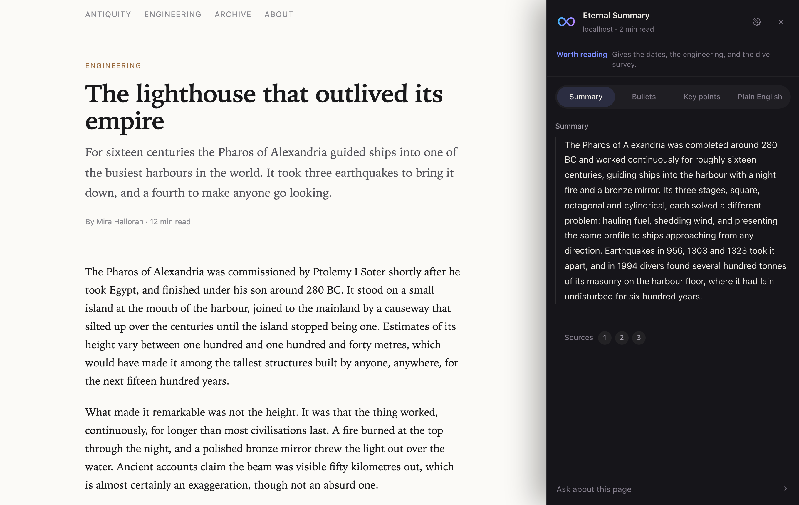
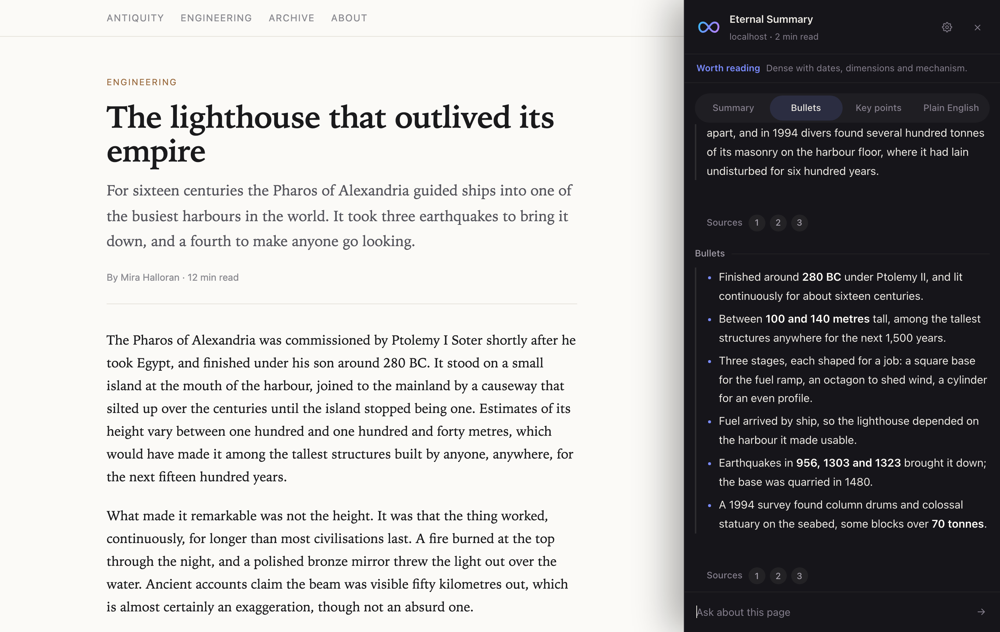
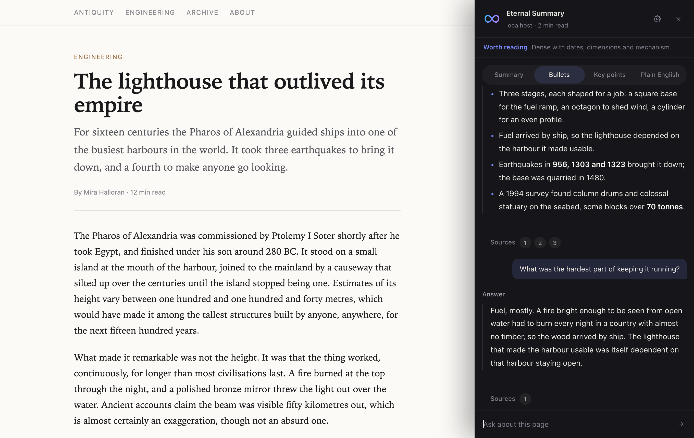
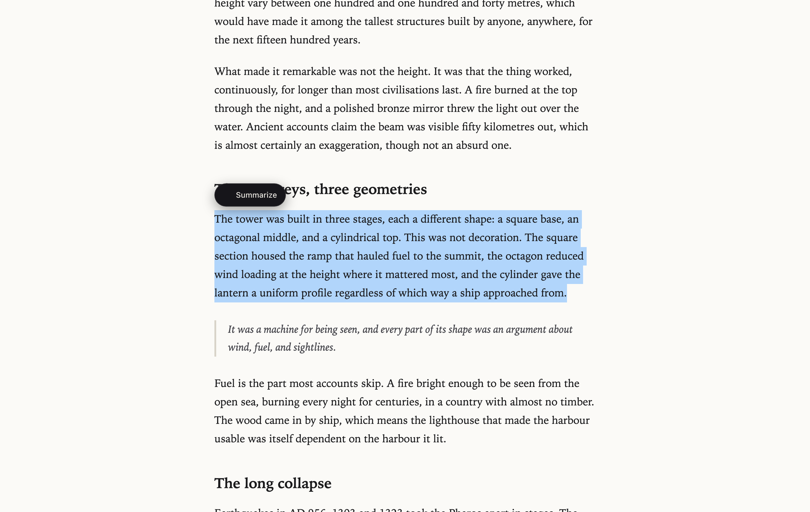
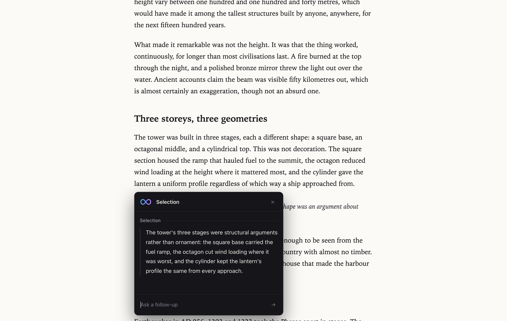

# Eternal Summary

[](https://github.com/sidebandstudio/Eternal-Summary/actions/workflows/ci.yml)

A Chrome extension that summarizes the page you are reading, explains anything you highlight, and answers follow-up questions without leaving the tab.

[Add to Chrome](https://chromewebstore.google.com/detail/eternal-summary/cpdeianknlpdhlbfdgckdcgfglbhkjbf), or read about it on the [live site](https://sidebandstudio.github.io/Eternal-Summary/).



## Features

- **Page summaries.** Click the toolbar icon or press the shortcut and the extension reads the page and returns a summary.
- **Four modes.** Summary, bullets, key points, or plain English. Switching modes re-reads the page in that style and appends the result, so the conversation above it stays intact. Your choice is remembered for next time.
- **Selection summaries.** Highlight text and a floating Summarize button appears next to it. The card that opens follows the highlight as you scroll.
- **Follow-up questions.** Ask anything about the page in the same panel. The thread scrolls on its own, keeps every turn, and only follows new messages when you are already at the bottom.
- **Clickable sources.** Every answer lists the passages it drew on. Clicking one scrolls to that passage and highlights it, without closing the panel.
- **Local caching.** Summaries are kept in extension storage for thirty minutes, so reopening a page you already read costs nothing.
- **Reading time, and whether it is worth it.** The header shows how long the page would take to read. Beside it, a one line verdict: worth reading, worth a skim, or probably skippable, with the reason.
- **Any language.** Summarize and ask in one of thirteen languages regardless of what the page is written in. Source snippets stay in the original so they can still be found on the page.
- **Settings.** Behind the gear in the panel header. Panel side and width, selection card size, default format, answer language, and switches for the floating button, the passage highlight, the typing animation and the cache.

## Screenshots

| Bullets mode | Follow-up questions |
| --- | --- |
|  |  |

| Highlight a passage | Summarize just that passage |
| --- | --- |
|  |  |

## Keyboard shortcut

`Cmd+Shift+S` on macOS, `Ctrl+Shift+S` elsewhere. `Esc` or the close button closes the panel. Reassign it at `chrome://extensions/shortcuts`.

## Install

[Add it from the Chrome Web Store.](https://chromewebstore.google.com/detail/eternal-summary/cpdeianknlpdhlbfdgckdcgfglbhkjbf) It talks to a hosted backend by default, so there is nothing to configure. Works in Chrome, Brave, Edge, Arc, and other Chromium browsers.

### From source

To run a change you made, or to read what you are running first:

1. Clone the repository:
   ```bash
   git clone https://github.com/sidebandstudio/Eternal-Summary.git
   ```
2. Open `chrome://extensions` and turn on **Developer mode**.
3. Click **Load unpacked** and select the cloned folder.

A source copy and the store copy can be installed side by side. They are separate extensions to Chrome, with separate storage.

## Running your own backend

The backend is a small Express service that proxies requests to the Gemini API. Run it if you would rather not use the hosted one.

```bash
cd backend
npm install
cp .env.example .env       # then put your Gemini API key in it
npm start                  # listens on port 3000
```

Deploying to Vercel: import the repository, set the root directory to `backend`, and add `GEMINI_API_KEY` under Settings > Environment Variables. Vercel runs `server.js` as an Express app with no build step. From the command line instead:

```bash
cd backend
vercel link                                  # pick the backend project
vercel env add GEMINI_API_KEY production
vercel deploy --prod
```

`vercel.json` keeps the server in Washington, D.C. (`iad1`). Google decides what a key may do by where the request comes from, and a free-tier key is refused from some countries, so the server stays in one place instead of running near each reader. `.env` is listed in `.vercelignore`, so the key never ships in an upload.

The server's own rate limit counts per instance, and Vercel runs more than one under load, so add a Firewall rule too: in the project's Firewall, a new rule where Request Path starts with `/api/`, then Rate Limit, 30 requests per 60 seconds, keyed by IP. Hobby includes one such rule.

`GEMINI_API_KEY` is required. Without it the server still starts and serves `/healthz`, but every summarize and ask request fails with a clear message in the logs.

To point the extension at your own deployment, change `API_BASE` in `background.js` and the matching entry in `host_permissions` in `manifest.json`.

### Endpoints

| Method | Path | Body | Returns |
| --- | --- | --- | --- |
| `GET` | `/healthz` | | `ok` |
| `POST` | `/api/summarize` | `{ text, mode, scope, lang }` | `{ summary, sources, verdict: { call, why } }` |
| `POST` | `/api/ask` | `{ text, messages, selection, lang }` | `{ answer, sources }` |

`mode` is one of `tldr`, `bullets`, `key-points`, or `simple`. `scope: "selection"` summarizes a highlighted passage: no verdict, and an empty summary when there is nothing to condense. `lang` is an optional language code such as `es`; without it the reply stays in the page's language. The two endpoints share one limit of 30 requests per minute per IP.

## Tests

Real Chrome, driven over the DevTools Protocol. Only the `chrome.*` API surface and the network are stubbed, so the tests exercise the actual message path: the panel asks `background.js` over `chrome.runtime`, and the worker calls the backend.

```bash
npm test        # 83 end-to-end tests in real Chrome
npm run check   # syntax check every entry point
npm run shots   # regenerate the screenshots on the docs site
npm run package # build the Chrome Web Store zip
```

The fixture page ships deliberately hostile CSS (`* { line-height: 1 !important }`, uppercase buttons, forced letter spacing) to prove the UI stays isolated. Coverage includes style isolation, markdown rendering, cache expiry and mode persistence, source lookup and highlight cleanup, focus trapping, error and rate-limit paths, and a check that repeated opens strand nothing on the page.

## Layout

```
Eternal-Summary/
├── manifest.json      Extension manifest (MV3)
├── background.js      Service worker. Owns the backend address and every network call.
├── listener.js        Content script. Selection button, storage, and opening the panel.
├── content.js         The panel itself. Imported into the content script's world on demand.
├── ui.css             Styles for the panel and the selection card
├── icons/             Extension icons, 16 through 512
├── test/              End-to-end tests and the CDP driver
├── tools/             Screenshot capture and the store package build
├── backend/           Express service that calls the Gemini API
└── docs/              Project site, published with GitHub Pages
```

The panel never sees the backend URL. It names an endpoint, the service worker rejects anything outside its allow list, and only then makes the request. The panel runs in the content script's isolated world, not the page's, and its shadow roots are closed, so a page script cannot press its buttons, forge its replies or post requests on its behalf. Its text can still be found and selected from the page, like any text on screen.

The UI renders inside a shadow root, with `ui.css` loaded into it. Page stylesheets cannot cross that boundary, so a site rule like `* { line-height: 1 !important }` cannot collapse the panel's text, and the panel cannot leak styles onto the page either.

## Privacy

Page text is sent to the backend only when you ask for a summary or an answer. Nothing is stored server side, and summaries are cached only in your own browser. See [Privacy.md](Privacy.md).

## License

Eternal Summary License, copyright 2025 Ali Tleis. See [LICENSE](LICENSE). You may not redistribute, modify for public use, or use this project commercially without permission.

## Author

Ali Tleis, Computer Science at Northeastern University. [GitHub](https://github.com/Alitleis123)
